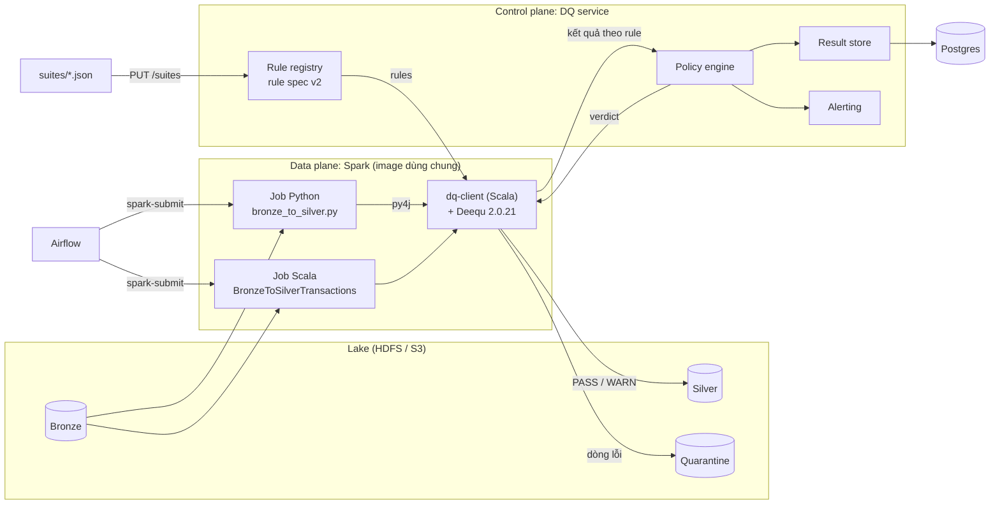

# Plan migrate DQ platform từ Great Expectations sang Deequ

> Trạng thái: **đã duyệt (2026-10-20)**, đang triển khai. Quyết định đã chốt ở mục 12.
> Môi trường đích: **Spark 3.5.1** (Scala 2.12.18, Java 17).
> Ngày khảo sát: 2026-10-20. Version Deequ/PyDeequ ghi bên dưới là kết quả kiểm tra trực tiếp trên Maven Central, PyPI và source Deequ tag `2.1.0`.

## 0. Tóm tắt

| | Hiện tại (GX) | Sau migrate (Deequ) |
|---|---|---|
| Engine validate | Great Expectations 1.24.0 (Python, chạy trên Spark) | **Deequ `2.0.21-spark-3.5`** (Scala, JVM) |
| Định dạng suite | GX ExpectationSuite JSON + `meta` | **Rule spec v2**: JSON riêng, không phụ thuộc engine, giữ `dimension` / `severity` / `row_level` |
| Thư viện client | `dq_client.py` (Python) | **`dq-client` viết bằng Scala** (một bản duy nhất). Python gọi qua py4j bằng wrapper mỏng |
| Tách quarantine | Parse chuỗi `unexpected_index_query` của GX (dễ vỡ khi nâng version) | API chính thức `VerificationResult.rowLevelResultsAsDataFrame` |
| Job | `bronze_to_silver.py` | `bronze_to_silver.py` (giữ, đổi ruột client) **+ `BronzeToSilverTransactions.scala` (mới)** |
| dq-service | Đọc kết quả GX, validate suite bằng GX | Đọc **kết quả trung lập** (theo rule), validate suite bằng Pydantic, **bỏ hẳn GX** |
| Không đổi | Kiến trúc control plane / data plane, Write-Audit-Publish, policy (`severity`, `row_level`, `max_quarantine_ratio`), exit code 0/2/3, 6 dimension, alert | |

Tiêu chí hoàn thành chính: **job Python và job Scala chạy trên cùng dữ liệu mẫu cho ra kết quả giống hệt nhau, và khớp baseline GX hiện tại**: 10.000 dòng, 308 quarantine, verdict WARN, publish 9.692 dòng (chi tiết ở mục 9, Phase 5).

---

## 1. Mục tiêu và ngoài phạm vi

**Mục tiêu**

1. Bỏ hoàn toàn Great Expectations khỏi Spark image, dq-service và suite.
2. Có **một** bộ diễn giải rule duy nhất (Scala), dùng chung cho mọi job, cả Python lẫn Scala, để hai loại job không thể cho kết quả khác nhau.
3. dq-service nhận kết quả theo format trung lập (không dính GX hay Deequ), để sau này đổi engine thì service không phải sửa nữa.
4. Thêm job Spark Scala `BronzeToSilverTransactions` tương đương job Python.
5. Giữ nguyên hành vi nghiệp vụ: 6 dimension, severity, quarantine, WAP, exit code.

**Ngoài phạm vi** (để phase sau, xem mục 9, Phase 7)

- Anomaly detection và metrics repository của Deequ.
- Constraint suggestion / profiling tự động cho dataset mới.
- Spark Connect / PyDeequ 2.0.

---

## 2. Kết quả khảo sát Deequ

| Hạng mục | Kết quả | Hệ quả cho plan |
|---|---|---|
| Deequ mới nhất | `2.1.0-spark-3.5` (tag 2026-09-16, **yêu cầu Java 11**) và `2.0.21-spark-3.5` (2026-06-18). Cả hai đều có trên Maven Central | Chọn **2.0.21** làm mặc định: bản ổn định mà README Deequ đang hướng dẫn cài, cũng là bản PyDeequ 1.7.0 đóng gói. 2.1.0 thay UDAF bằng typed aggregator (thay đổi lõi lớn), nên chờ thêm |
| Build target | Scala 2.12, build với Spark 3.5.7 | Spark 3.5.1 cùng dòng 3.5.x nên tương thích nhị phân theo chính sách của Spark, nhưng vẫn phải chứng minh ở Phase 0 bằng cách chạy test trên đúng Spark 3.5.1. Image dùng `apache/spark:3.5.1-scala2.12-java17-python3-ubuntu` |
| Phụ thuộc của Deequ | `spark-core/sql/mllib` và `scala-library` để scope **compile**; thêm `breeze 2.1.0` và `software.amazon.glue:dqdl:1.0.7` | Khi build assembly phải **exclude** spark và scala. Cân nhắc exclude `dqdl` để tránh xung đột `antlr4` với Spark (cần kiểm chứng ở spike) |
| PyDeequ | 1.7.0 (2026-09-14): chỉ hỗ trợ Spark 3.5, đi kèm Deequ 2.0.21, có `rowLevelResultsAsDataFrame` (từ 1.6.0), có DQDL. PyDeequ 2.0 (Spark Connect) mới ở **beta** | Dùng được, nhưng plan **không chọn** (lý do ở D2) |
| Check API | Có `isComplete`, `hasCompleteness`, `isUnique`, `hasUniqueness`, `hasPattern`, `isContainedIn` (tập giá trị và khoảng số), `satisfies`, `hasSize`, `hasMean`, `customSql`, `hasColumn`, `hasDataType`... | Đủ để chuyển toàn bộ 21 rule hiện tại (bảng ở mục 5) |
| Row-level | Analyzer có kết quả theo dòng: `Completeness`, `Compliance` (`satisfies`, `isContainedIn`), `PatternMatch`, `Uniqueness`, `Minimum`/`Maximum`... Hàm `rowLevelResultsAsDataFrame` trả về **một cột boolean cho mỗi Check**, tên cột lấy theo `check.description` | Mỗi rule ứng với **một Check**, `description = rule.id`. Thay được trọn vẹn cách parse `unexpected_index_query` |
| DQDL | `EvaluateDataQuality.process / processRows` đã có, nhưng row-level chỉ hỗ trợ `IsComplete`, `IsUnique`, `ColumnValues IN/NOT IN`, `Completeness`, `Uniqueness`. Rule cũng không gắn được metadata (`dimension`, `severity`) | **Không dùng DQDL** làm format suite (lý do ở D1) |

---

## 3. Các quyết định thiết kế

### D1. Định dạng suite: rule spec v2 (JSON riêng), không dùng DQDL, không giữ format GX

- **Chọn:** JSON riêng, mỗi rule có `id`, `dimension`, `severity`, `row_level`, `check{kind, ...}`. Client dịch `kind` sang Deequ Check.
- **Loại DQDL:** không gắn được `dimension`/`severity` cho từng rule, và row-level không hỗ trợ regex, khoảng giá trị hay điều kiện SQL. Đây đúng là các rule quarantine mà suite đang cần.
- **Loại giữ format GX:** dịch tên expectation của GX sang Deequ là trói service và suite vào từ vựng của một engine đã bỏ.
- **Lợi ích thêm:** `rule.id` ổn định nên dùng luôn làm tên lỗi trong `_dq_errors`. Việc này sửa được lỗi trùng tên `type:column` hiện tại khi có hai rule cùng loại trên cùng cột.

### D2. Một bộ diễn giải rule duy nhất trong JVM. Python là wrapper py4j, không dùng PyDeequ

- **Chọn:** thư viện Scala `dq-client` chứa toàn bộ logic (tải suite, thay parameter, dựng Check, chạy Deequ, tách quarantine, gọi service). Job Scala dùng trực tiếp. Job Python gọi qua `spark._jvm`.
- **Vì sao không dùng PyDeequ:** nếu Python dùng PyDeequ còn Scala dùng Deequ thì phải viết **hai** bộ dịch rule song song. Theo thời gian hai bộ sẽ lệch nhau (cùng suite, hai job cho verdict khác nhau), mà đây là rủi ro lớn nhất của nền tảng DQ dùng chung. PyDeequ bản chất cũng là py4j bọc Deequ, nên tự bọc không mất gì mà lại khóa được một nguồn sự thật.
- **Đánh đổi:** py4j không có trên **Spark Connect**. Nếu sau này chạy job Python qua Spark Connect thì cần xem lại (PyDeequ 2.0 đang đi hướng này nhưng còn beta).

### D3. Quarantine bằng `rowLevelResultsAsDataFrame`

Bỏ `_extract_condition` và `ast.literal_eval` trên chuỗi nội bộ của GX. Deequ trả về DataFrame gốc kèm một cột boolean cho mỗi Check. Client gom các cột có `row_level=true` thành `_dq_errors = array(rule_id...)`, rồi tách thành `valid` và `quarantine`. Toàn bộ là phép biến đổi lazy trên executor, giống hiện tại.

### D4. Suite parameter: `${name}` trong SQL, `{"param": ...}` trong assertion

GX `$PARAMETER` bị thay bằng cơ chế riêng, đơn giản hơn:

- Chuỗi SQL (`predicate`, `sql`) dùng `${partition_start}`. Client thay giá trị trước khi đưa cho Deequ.
- Ngưỡng số dùng `{"param": "source_row_count"}`.
- **Ngưỡng vẫn nằm trong suite**, ví dụ freshness viết `TIMESTAMP '${partition_end}' - INTERVAL 60 MINUTES` ngay trong SQL. Job chỉ truyền dữ kiện.
- Suite khai báo danh sách parameter. Service từ chối suite tham chiếu parameter chưa khai báo; client fail nếu job không truyền đủ.

### D5. Rule schema chạy ở client (không cần Spark job)

Deequ có `hasColumn` nhưng không có so khớp chính xác tập cột, và `hasDataType` chỉ suy kiểu cho cột **string** (Fractional/Integral/Boolean...), không kiểm được `DecimalType`/`TimestampType` của Spark. Vì vậy hai kind `schema_columns` và `schema_type` được client đánh giá trực tiếp trên `df.schema`, rồi trả kết quả cùng format với rule Deequ.

### D6. Verdict vẫn do dq-service quyết định

Client không tự kết luận PASS/FAIL. Client gửi kết quả từng rule (đạt/không đạt, metric, số dòng lỗi), còn service áp policy. Logic `decide()` giữ nguyên ý nghĩa, chỉ đổi input từ format GX sang format trung lập.

### D7. Mỗi rule là một Deequ Check riêng

`Check(level, description = rule.id).<constraint>`. Có ba lý do:

1. Lấy được kết quả theo từng rule.
2. Cột row-level mang đúng tên `rule.id`.
3. Hiệu năng không đổi: Deequ gộp analyzer của mọi Check để quét dữ liệu ít lần nhất, không phụ thuộc cách chia Check.

`CheckLevel` chỉ để hiển thị (`error` ứng với `CheckLevel.Error`, `warn` ứng với `CheckLevel.Warning`). Verdict không dựa vào status tổng của Deequ.

---

## 4. Kiến trúc sau migrate



Khác biệt so với hiện tại: bỏ GX khỏi Spark và service, có thêm một client JVM dùng chung, và có thêm job Scala.

---

## 5. Rule spec v2

### 5.1 Cấu trúc

```jsonc
{
  "dataset": "silver.transactions",
  "policy": { "max_quarantine_ratio": 0.05, "owner": "team-billing" },
  "suite": {                               // phần lưu trong registry; PUT /suites nhận {suite, policy}
   "format": "dq-rules/v2",
   "parameters": {                         // job phải truyền đủ, service kiểm tham chiếu
    "partition_start":  "yyyy-MM-dd 00:00:00 của dt",
    "partition_end":    "yyyy-MM-dd 00:00:00 của dt+1",
    "source_row_count": "số giao dịch khác nhau ở Bronze"
   },
   "rules": [
    {
      "id": "msisdn_format",               // duy nhất trong suite, [a-z0-9_]+, dùng làm tên lỗi quarantine
      "dimension": "validity",             // 1 trong 6
      "severity": "error",                 // error | warn
      "row_level": true,                   // true = dòng vi phạm vào quarantine
      "description": "...",                // tùy chọn, hiện trong alert
      "check": { "kind": "pattern", "column": "msisdn", "regex": "^84[0-9]{9}$",
                 "assert": { "op": ">=", "value": 0.97 } }
    }
   ]
  }
}
```

`assert` gồm `op` (`>=`, `>`, `<=`, `<`, `==`, `between`), cộng với `value` hoặc `min`/`max`. Giá trị là số hoặc `{"param": "..."}`. Với các kind dạng tỉ lệ (`complete`, `pattern`, `range`, `in_set`, `sql_predicate`, `unique`), nếu bỏ trống `assert` thì mặc định là `== 1.0`.

### 5.2 Danh sách `kind` và ánh xạ sang Deequ

| kind | Tham số | Deequ | Row-level |
|---|---|---|---|
| `size` | `assert` | `hasSize` | không |
| `complete` | `column` | `isComplete` | có |
| `completeness` | `column`, `assert` | `hasCompleteness` | có (thường dùng ở mức batch) |
| `unique` | `columns[]`, `assert` | `hasUniqueness(columns, ...)` (1 cột: `isUnique`) | có |
| `pattern` | `column`, `regex`, `assert` | `hasPattern(...).where("col IS NOT NULL")` + `AnalyzerOptions(filteredRow = TRUE)` | có |
| `range` | `column`, `min`, `max` | `isContainedIn(column, lower, upper, includeLower, includeUpper)` | có |
| `in_set` | `column`, `values[]` | `isContainedIn(column, Array(...))` | có |
| `mean` | `column`, `assert` | `hasMean` | không |
| `sql_predicate` | `predicate`, `columns[]`, `assert` | `satisfies(predicate, id, ...)` | có |
| `sql_metric` | `sql` (trả về 1 số), `assert` | `customSql`, chạy trên temp view `${batch}` do client đăng ký | không |
| `schema_columns` | `columns[]`, `exact` | client so `df.columns` | không |
| `schema_type` | `column`, `type` (`decimal`, `timestamp`, `string`...) | client so `df.schema` | không |

### 5.3 Chuyển đổi suite `silver.transactions` (21 rule)

| # | Rule id | Dim. | Sev. | GX hiện tại | Rule spec v2 |
|---|---|---|---|---|---|
| 1 | `row_count_min` | completeness | error | `expect_table_row_count_to_be_between` min 1000 | `size`, `>= 1000` |
| 2 | `row_count_reconcile` | completeness | error | `expect_table_row_count_to_equal` `$PARAMETER` | `size`, `== {"param":"source_row_count"}` |
| 3–8 | `<col>_not_null` ×6 | completeness | error, row | `expect_column_values_to_not_be_null` | `complete` |
| 9 | `province_code_completeness` | completeness | warn | not_null, mostly 0.9 | `completeness`, `>= 0.9` |
| 10 | `transaction_id_unique` | uniqueness | error | `expect_column_values_to_be_unique` | `unique` `["transaction_id"]` |
| 11 | `business_duplicate` | uniqueness | warn | `expect_compound_columns_to_be_unique` | `unique` (4 cột) |
| 12 | `schema_exact` | validity | error | `expect_table_columns_to_match_set` | `schema_columns`, `exact: true` |
| 13–14 | `amount_type`, `event_time_type` | validity | error | `expect_column_values_to_be_of_type` | `schema_type` |
| 15 | `msisdn_format` | validity | error, row | regex, mostly 0.97 | `pattern`, `>= 0.97` |
| 16 | `amount_range` | validity | error, row | between 0..1e8 | `range` 0..1e8 |
| 17 | `status_domain` | validity | error, row | in_set | `in_set` |
| 18 | `msisdn_carrier_prefix` | accuracy | warn | regex, mostly 0.99 | `pattern`, `>= 0.99` |
| 19 | `amount_mean` | accuracy | warn | `expect_column_mean_to_be_between` | `mean`, `between 10000..500000` |
| 20 | `event_time_in_partition` | consistency | error, row | between `$PARAMETER`, strict_max | `sql_predicate` (bên dưới) |
| 21 | `freshness_end_of_day` | timeliness | warn | `expect_column_max_to_be_between` | `sql_metric` (bên dưới) |

Hai rule cần SQL:

```json
{"id": "event_time_in_partition", "dimension": "consistency", "severity": "error", "row_level": true,
 "check": {"kind": "sql_predicate", "columns": ["event_time"],
           "predicate": "event_time IS NULL OR (event_time >= TIMESTAMP '${partition_start}' AND event_time < TIMESTAMP '${partition_end}')"}}

{"id": "freshness_end_of_day", "dimension": "timeliness", "severity": "warn",
 "check": {"kind": "sql_metric",
           "sql": "SELECT CAST(max(event_time) >= TIMESTAMP '${partition_end}' - INTERVAL 60 MINUTES AS DOUBLE) FROM ${batch}",
           "assert": {"op": "==", "value": 1}}}
```

---

## 6. Khác biệt ngữ nghĩa GX và Deequ cần xử lý

Đây là nơi dễ sinh lệch kết quả nhất. Mỗi dòng bên dưới phải có test ở Phase 0.

| Chủ đề | GX | Deequ (đã đọc source 2.1.0) | Cách xử lý |
|---|---|---|---|
| Null với regex | Bỏ qua null, tỉ lệ `mostly` tính trên dòng **không null** | `PatternMatch`: `regexp_extract(null)` cho ra `null`, rơi vào `otherwise(0)`, tức là null bị tính là **không khớp** | `.where("col IS NOT NULL")`: mẫu số loại null. `AnalyzerOptions(filteredRow = FilteredRowOutcome.TRUE)`: dòng null được tính là đạt ở row-level |
| Null với `satisfies` | (không có tương đương) | Predicate ra `null` thì không được tính là đạt | Viết predicate null-safe: `col IS NULL OR (...)`. Null do rule completeness lo, tránh một dòng bị tính lỗi hai lần |
| Null với `isContainedIn` | Bỏ qua null | Predicate sinh ra đã là `col IS NULL OR ...` | Không cần làm gì |
| Null với uniqueness | Bỏ qua null | `GroupingAnalyzers` lọc dòng mà mọi cột group đều null, ở **cả tử số lẫn mẫu số** | Tương đương, chỉ cần test xác nhận |
| Regex | `RLIKE` (find) | `regexp_extract(...) != ""` (find) | Tương đương nếu regex có `^...$`. Service cảnh báo khi regex thiếu anchor. Lưu ý regex được Java engine thực thi (service validate bằng Python `re` chỉ là kiểm tra gần đúng) |
| Kiểu dữ liệu | `expect_column_values_to_be_of_type` theo class Spark | `hasDataType` chỉ suy kiểu cho cột string | Kind `schema_type` chạy ở client (D5) |
| `between` có `strict_max` | Có | `isContainedIn(..., includeUpper = false)` | Map trực tiếp |
| Mean trên decimal | Trả về float | `Mean` cast sang double | Tương đương |
| Lỗi khi chạy rule | Ghi `exception_info`, rule bị `success = false` | Constraint `Failure` kèm message (ví dụ thiếu cột, SQL lỗi) | Client gửi `status: "error"` kèm `message`. Service coi như rule **fail** theo severity của nó, không im lặng bỏ qua |

---

## 7. Thay đổi theo thành phần

### 7.1 `suites/`

- Viết lại `silver_transactions.json` theo rule spec v2 (mục 5.3).
- Thêm `suites/schema/dq-rules-v2.schema.json` (JSON Schema) để CI và IDE kiểm tra cú pháp ngay trong PR.

### 7.2 `dq-service/`

| Phần | Hiện tại | Sau migrate |
|---|---|---|
| `requirements.txt` | có `great_expectations==1.24.0` | **bỏ GX**, image service nhẹ hơn hẳn |
| Validate suite (`PUT`) | `gx.ExpectationSuite(**suite)` + kiểm `dimension` | Model Pydantic `Suite` / `Rule` / `Check` (discriminated union theo `kind`). Kiểm thêm: `id` duy nhất, `dimension` thuộc 6, mọi `${x}` / `{"param": x}` đã khai báo trong `parameters`, regex compile được, `row_level` chỉ đặt cho kind có hỗ trợ row-level |
| Seed khi startup | GX suite | Rule spec v2, dùng chung hàm validate |
| `POST /runs`, model `RunIn` | `validation_result` = output GX | `results[]` trung lập (mục 8) + `engine`, `client`, `parameters` |
| `decide()` | Duyệt `results` của GX, đọc `meta` | Duyệt `results[]` trung lập. Quy tắc giữ nguyên: rule fail và `severity = error` cho ra FAIL, `warn` cho ra WARN. Rule row-level có ngưỡng `== 1.0` thì bỏ qua (dòng lỗi đã vào quarantine), còn `max_quarantine_ratio` vẫn áp như cũ. Thêm: `status = error` (rule không chạy được) cũng tính là fail |
| `dimension_summary()` | Đọc `meta.dimension` của GX | Đọc `results[].dimension` |
| Lưu kết quả | `dq_expectation_results` | Bảng mới `dq_rule_results` (mục 7.3) |
| `GET /runs` | | Thêm `engine`, `client` |
| Alert | | Không đổi, chỉ đổi text lý do: `[error][validity] msisdn_format` |

Tách `app.py` thành module (`models.py`, `policy.py`, `store.py`, `app.py`) để `decide()` test được độc lập. Hiện file đã gần 300 dòng và sẽ dài thêm.

### 7.3 `postgres/init.sql`

```sql
ALTER TABLE dq_runs ADD COLUMN IF NOT EXISTS engine TEXT;    -- vd deequ-2.0.21-spark-3.5
ALTER TABLE dq_runs ADD COLUMN IF NOT EXISTS client TEXT;    -- python | scala
ALTER TABLE dq_runs RENAME COLUMN gx_result TO raw_result;   -- payload gốc (đã cắt gọn)

CREATE TABLE IF NOT EXISTS dq_rule_results (
    id            BIGSERIAL PRIMARY KEY,
    run_id        TEXT REFERENCES dq_runs(run_id) ON DELETE CASCADE,
    dataset       TEXT,
    rule_id       TEXT,
    kind          TEXT,
    column_name   TEXT,
    dimension     TEXT,
    severity      TEXT,
    row_level     BOOLEAN,
    status        TEXT,              -- passed | failed | error
    metric_name   TEXT,              -- Completeness, PatternMatch, Size, Mean...
    metric_value  DOUBLE PRECISION,
    failed_rows   BIGINT,            -- chỉ rule row-level
    message       TEXT,
    created_at    TIMESTAMPTZ NOT NULL DEFAULT now()
);
CREATE INDEX IF NOT EXISTS idx_dq_rule_dim ON dq_rule_results (dataset, dimension, created_at DESC);
CREATE INDEX IF NOT EXISTS idx_dq_rule_id  ON dq_rule_results (dataset, rule_id, created_at DESC);
```

Bảng `dq_expectation_results` cũ giữ nguyên ở chế độ chỉ đọc (lịch sử), không ghi thêm. Dashboard chuyển sang `dq_rule_results`. Với môi trường demo có thể `docker compose down -v` cho gọn.

### 7.4 Thư viện `dq-client` (Scala), thư mục mới `jvm/`

```
jvm/                                  # build bằng Maven (multi-module)
├── pom.xml                           # parent: Scala 2.12.18, Spark 3.5.1 "provided", Deequ 2.0.21-spark-3.5,
│                                     # scala-maven-plugin, scalatest-maven-plugin, maven-shade-plugin
├── dq-client/pom.xml                 # thư viện (jar thường)
├── dq-client/src/main/scala/dqplatform/client/
│   ├── RuleSpec.scala                # case class Suite / Rule / Check / Assertion, parse JSON bằng Jackson
│   ├── Params.scala                  # thay ${x} và {"param": x}; thiếu parameter -> lỗi rõ ràng
│   ├── DeequChecks.scala             # Rule -> com.amazon.deequ.checks.Check (bảng 5.2)
│   ├── SchemaRules.scala             # schema_columns, schema_type (chạy trên df.schema)
│   ├── RowLevel.scala                # rowLevelResultsAsDataFrame -> _dq_errors, valid / quarantine,
│   │                                 # đếm failed_rows mọi rule trong MỘT lần aggregate
│   ├── ServiceClient.scala           # java.net.http.HttpClient + timeout + Bearer token từ env DQ_API_TOKEN
│   ├── DQClient.scala                # validate(df, partitionSpec, params): DQResult; đọc spark.dq.* như bản Python
│   │                                 # + validateForPython(..., java.util.Map) cho py4j
│   └── DQResult.scala                # runId, verdict, reasons, rowCount, quarantinedRows, validDf, quarantineDf, shouldPublish
├── dq-client/src/test/scala/...      # ScalaTest + SparkSession local
├── dq-jobs/pom.xml                   # maven-shade-plugin -> target/dq-platform.jar (client + job + Deequ)
└── dq-jobs/src/main/scala/dqplatform/jobs/
    └── BronzeToSilverTransactions.scala
```

Build: `mvn -f jvm/pom.xml -B package` chạy compile, ScalaTest rồi shade, cho ra `jvm/dq-jobs/target/dq-platform.jar`.

Ghi chú build:

- **Dependency của Deequ:** Deequ khai báo Spark và Scala ở scope `compile`, nên trong `pom.xml` phải khai `<exclusions>` cho `org.apache.spark:*` và `org.scala-lang:*` ở dependency `deequ`. Spark khai riêng với scope `provided`, nếu không jar shade sẽ nhét cả Spark vào.
- **`breeze` và `dqdl`:** `breeze` đã có sẵn trong Spark distribution (cùng bản 2.1.0) nên exclude. `dqdl` không dùng, exclude để tránh xung đột `antlr4` với Spark (kiểm ở Phase 0).
- **JSON:** dùng Jackson (`jackson-module-scala`) đi kèm Spark, scope `provided`, không kéo bản Jackson khác vào để tránh xung đột classpath.
- **Jar đầu ra:** một file `dq-platform.jar` (shade) chứa `dq-client`, job Scala và Deequ. Job Python cũng nạp jar này.

Luồng `DQClient.validate` giữ y hệt bản Python hiện tại (cache + count, GET suite, chạy rule, tách quarantine, POST run, xử lý mode monitor, fail-open/fail-closed). Khác ở bước chạy rule:

1. Đăng ký `df` làm temp view `dq_batch_<runId>`, dùng làm giá trị cho `${batch}`.
2. Chạy rule schema (D5) trên `df.schema`.
3. `VerificationSuite().onData(df).addChecks(checks).run()`: mọi rule Deequ chạy trong số lần quét tối thiểu.
4. `rowLevelResultsAsDataFrame`, rồi tạo `_dq_errors` từ các rule `row_level`.
5. Gộp kết quả 2, 3, 4 thành `results[]` trung lập.

### 7.5 `spark/jobs/dq_client.py`: thành wrapper mỏng

```python
class DQClient:
    def __init__(self, spark):
        self._spark = spark
        self._j = spark._jvm.dqplatform.client.DQClient.fromSession(spark._jsparkSession)

    def validate(self, df, partition_spec=None, suite_parameters=None) -> DQResult:
        try:
            jres = self._j.validateForPython(df._jdf, partition_spec,
                                             {k: str(v) for k, v in (suite_parameters or {}).items()})
        except Py4JJavaError as e:
            if "DQFailedException" in str(e.java_exception.getClass().getName()):
                raise DQFailed(e.java_exception.getMessage()) from e
            raise
        return DQResult(... valid_df=DataFrame(jres.validDf(), self._spark), ...)
```

- **API giữ nguyên** (`DQClient`, `validate`, `DQResult`, `DQFailed`, `should_publish`), nên `bronze_to_silver.py` gần như không phải sửa.
- **Bỏ phụ thuộc** `great_expectations` và `requests`, cùng toàn bộ code GX: `_run_gx`, `_extract_condition`, `_split`, `_slim`.

### 7.6 `spark/jobs/bronze_to_silver.py`

Thay đổi tối thiểu: `suite_parameters` đổi thành giá trị chuỗi (đã đúng dạng), còn lại giữ nguyên. Logic transform, dedup giữ dòng thiếu khóa, `source_row_count` và WAP đều không đổi.

### 7.7 Job Scala `BronzeToSilverTransactions.scala`

Tương đương 1-1 với job Python để làm phép thử parity:

```scala
object BronzeToSilverTransactions {
  def main(args: Array[String]): Unit = {
    val conf  = Args.parse(args)                         // --dt, --lake
    val spark = SparkSession.builder.appName("bronze_to_silver_transactions_scala").getOrCreate()

    val raw = spark.read.parquet(s"${conf.lake}/bronze/transactions/dt=${conf.dt}")
    val df  = Transform.transactions(raw, conf.dt)        // trim/upper/cast/dedup giống bản Python
    val params = Map(
      "partition_start"  -> s"${conf.dt} 00:00:00",
      "partition_end"    -> s"${conf.dt.plusDays(1)} 00:00:00",
      "source_row_count" -> SourceStats.distinctTransactions(raw).toString)

    val res = try DQClient.fromSession(spark).validate(df, s"dt=${conf.dt}", params)
              catch { case e: DQFailedException => System.err.println(e.getMessage); sys.exit(2) }

    res.quarantineDf.foreach(Quarantine.write(_, res.runId, quarantineRoot))
    if (!res.shouldPublish) { System.err.println(s"DQ ${res.verdict}: ${res.reasons}"); sys.exit(3) }
    Wap.publish(res.validDf, stagingRoot, silverPath, res.runId)  // write staging -> rename atomic
  }
}
```

`Transform`, `Quarantine`, `Wap` là object nhỏ, có unit test. Exit code giữ đúng hợp đồng với Airflow: 0 / 2 / 3.

### 7.8 `spark/Dockerfile`, `spark/conf/spark-defaults.conf`, `docker-compose.yml`

- **Dockerfile multi-stage:**
  - stage `build`: `maven:3.9-eclipse-temurin-17`, chạy `mvn -B package` (gồm cả test);
  - stage cuối: `apache/spark:3.5.1-scala2.12-java17-python3-ubuntu`, copy jar vào `/opt/dq/jars/`, **bỏ `pip install great_expectations`**.
- **`spark-defaults.conf`:** thêm `spark.jars /opt/dq/jars/dq-platform-assembly.jar` để cả job Python lẫn Scala đều có client. Bỏ `spark.dq.max.unexpected.keys` (không còn dùng).
- **`docker-compose.yml`:** thêm service `spark-bronze-to-silver-scala` (`spark-submit --class dqplatform.jobs.BronzeToSilverTransactions`). Theo quyết định Q3, job Scala ghi vào **thư mục riêng**:
  - Silver: `<lake>/silver_scala/transactions/dt=...`
  - Quarantine: `<quarantine>/transactions_scala`
  - Staging: `<staging>/transactions_scala/<run_id>`

  Hai job cùng đọc một Bronze và cùng dùng suite `silver.transactions`. Run trong service được phân biệt bằng cột `client`.

### 7.9 Tài liệu

- **README:** cập nhật stack, bảng quy ước suite (rule spec v2), bỏ ghi chú về GX/UDF trên executor, thêm hướng dẫn build và chạy job Scala.
- **Tài liệu mới `docs/RULE_SPEC_V2.md`:** mô tả đầy đủ các kind kèm ví dụ (rút từ mục 5 của plan này).

---

## 8. Hợp đồng API mới: `POST /api/v1/runs`

```json
{
  "run_id": "bronze_to_silver_transactions_scala-3f9c1a2b7d10",
  "dataset": "silver.transactions",
  "partition_spec": "dt=2026-10-17",
  "job_name": "bronze_to_silver_transactions_scala",
  "client": "scala",
  "engine": "deequ-2.0.21-spark-3.5",
  "suite_version": 3,
  "parameters": {"partition_start": "2026-10-17 00:00:00", "partition_end": "2026-10-18 00:00:00", "source_row_count": "10000"},
  "row_count": 10000,
  "quarantined_rows": 308,
  "results": [
    {"rule_id": "msisdn_format", "kind": "pattern", "column": "msisdn",
     "dimension": "validity", "severity": "error", "row_level": true, "threshold": 0.97,
     "status": "passed", "metric_name": "PatternMatch", "metric_value": 0.9948,
     "failed_rows": 52, "message": null},
    {"rule_id": "province_code_completeness", "kind": "completeness", "column": "province_code",
     "dimension": "completeness", "severity": "warn", "row_level": false, "threshold": 0.9,
     "status": "failed", "metric_name": "Completeness", "metric_value": 0.7826,
     "failed_rows": null, "message": "Value: 0.7826 does not meet the constraint requirement!"}
  ]
}
```

Response giữ nguyên: `{run_id, verdict, reasons, dimensions}`.

`threshold` do client tính sẵn từ `assert`. Service dùng nó cho quy tắc "rule row-level có ngưỡng 1.0 thì không tự làm FAIL batch", thay cho việc kiểm `"mostly" in kwargs` như hiện tại.

---

## 9. Lộ trình

Ước lượng tính cho một người đã quen codebase.

| Phase | Nội dung | Đầu ra | Tiêu chí xong | Ước lượng |
|---|---|---|---|---|
| **0. Spike** | Chạy Deequ 2.0.21 trên Spark 3.5.1 local với dữ liệu mẫu, kiểm từng dòng của mục 6, kiểm `rowLevelResultsAsDataFrame` với `where` + `FilteredRowOutcome.TRUE`, kiểm exclude `dqdl` / `breeze` khi build assembly | Ghi chú kết quả + test tái hiện | Mọi khác biệt ở mục 6 đã có cách xử lý được chứng minh bằng test | 1 ngày |
| **1. Rule spec v2 + service** | Pydantic models, validate suite, `decide()` trên format mới, bảng `dq_rule_results`, chuyển `silver_transactions.json` | Service mới + pytest | `decide()` có test cho mọi nhánh (error/warn/row-level/threshold/quarantine ratio/status error); PUT suite sai bị trả 422 với thông báo rõ | 1,5 ngày |
| **2. `dq-client` Scala** | `RuleSpec`, `Params`, `DeequChecks`, `SchemaRules`, `RowLevel`, `ServiceClient`, `DQClient` | Thư viện + ScalaTest (≥ 80% coverage) | Mỗi `kind` có test pass/fail/null; test tích hợp với service giả lập (WireMock hoặc HTTP server nhúng) | 3 ngày |
| **3. Python wrapper** | Viết lại `dq_client.py` thành py4j wrapper, sửa nhỏ `bronze_to_silver.py` | Job Python chạy được trên Deequ | pytest cho chuyển đổi tham số và lỗi; job chạy end-to-end | 0,5 ngày |
| **4. Job Scala + đóng gói** | `BronzeToSilverTransactions`, Dockerfile multi-stage, compose service mới, `spark.jars` | Image mới không có GX | `docker compose run spark-bronze-to-silver-scala` chạy end-to-end | 1,5 ngày |
| **5. Parity + nghiệm thu** | Chạy cả hai job trên cùng Bronze (seed 42) và so với baseline GX | Script `scripts/parity_check.sh` | **Python = Scala = baseline**: 10.000 dòng, quarantine 308 (cùng tập `transaction_id`, cùng `_dq_errors` theo rule), WARN do `province_code_completeness`, publish 9.692. Kịch bản `--bad-ratio 0.12` cho exit 3 ở cả hai. Tắt service cho exit 2 (fail-closed) và SKIPPED (fail-open) | 1 ngày |
| **6. Dọn dẹp** | Bỏ GX khỏi mọi requirements và Dockerfile, xóa code GX, cập nhật README, `docs/RULE_SPEC_V2.md` | | `grep -ri great_expectations` không còn kết quả nào ngoài docs lịch sử | 0,5 ngày |
| **7. (Tùy chọn)** | Deequ anomaly detection cho volume và freshness (metric lưu ở dq-service, không dùng metrics repository trên HDFS), constraint suggestion khi onboard dataset mới | | | sau |

**Tổng: khoảng 9 ngày làm việc** cho Phase 0–6.

Thứ tự triển khai: Phase 0 trước tiên, vì kết quả có thể làm đổi bảng 5.2. Phase 1 và 2 làm song song được. Đổi hẳn sang stack mới (cut-over) chỉ sau khi Phase 5 đạt.

---

## 10. Chiến lược test

| Lớp | Công cụ | Phạm vi |
|---|---|---|
| Service | pytest | Validate rule spec (đúng/sai từng kind, parameter thiếu, trùng id, dimension sai), `decide()`, `dimension_summary()`, lưu `dq_rule_results` (sqlite) |
| Client Scala, unit | ScalaTest + SparkSession `local[1]` | Mỗi kind × {pass, fail, null}; thay parameter; row-level ra đúng `_dq_errors`; rule chạy lỗi (cột không tồn tại, SQL sai) cho `status = error` |
| Client Scala, tích hợp | ScalaTest + HTTP server giả | Service sập (fail-open/fail-closed), timeout, 401, mode monitor |
| Python wrapper | pytest + Spark local + jar | Chuyển đổi kiểu qua py4j, map `DQFailedException` thành `DQFailed` |
| Đầu cuối | `scripts/parity_check.sh` | Mục 9, Phase 5 |

---

## 11. Rủi ro

| Rủi ro | Mức | Giảm thiểu |
|---|---|---|
| Ngữ nghĩa null/mẫu số của Deequ khác GX, làm số quarantine hoặc verdict lệch | Cao | Phase 0 kiểm từng mục ở bảng 6; parity test là cổng nghiệm thu |
| Xung đột classpath (Jackson, antlr4 của `dqdl`, breeze) khi nạp jar vào Spark | Trung bình | Exclude theo 7.4, test jar trên đúng image `apache/spark:3.5.1`; nếu vẫn xung đột thì relocate package bằng `maven-shade-plugin` |
| Deequ chỉ build cho một số bản Spark nhất định (hiện tối đa 3.5.x), nên nâng Spark phải chờ Deequ | Trung bình | Pin version trong `jvm/pom.xml`. Theo dõi PyDeequ đã thêm Spark 4.1 (PR #287), Deequ cho Spark 4 chưa có trên Maven ở thời điểm khảo sát |
| py4j không có trên Spark Connect | Thấp (hiện chạy `spark-submit` thường) | Ghi nhận; nếu chuyển sang Spark Connect thì đánh giá PyDeequ 2.0 hoặc chạy client phía server |
| `customSql` cần temp view, có thể trùng tên khi nhiều job chạy chung một session | Thấp | Tên view kèm `runId`, drop sau khi chạy |
| Regex được Python validate nhưng Java thực thi | Thấp | Service chỉ kiểm cơ bản; test Scala chạy regex thật của suite trong CI |

---

## 12. Quyết định đã chốt (2026-10-20)

| # | Câu hỏi | Quyết định |
|---|---|---|
| Q1 | Version Deequ | **`2.0.21-spark-3.5`** |
| Q2 | Cách chuyển đổi | **Chuyển hẳn sang Deequ** (không chạy song song GX). GX bị xóa ở Phase 6 sau khi parity đạt |
| Q3 | Job Scala ghi vào đâu | **Thư mục riêng** (`silver_scala`, `transactions_scala`), xem 7.8 |
| — | Version Spark | **3.5.1**: `provided` trong `jvm/pom.xml`, image `apache/spark:3.5.1-...`, `pyspark==3.5.1` khi test local |
| — | Build tool cho Scala | **Maven** (multi-module `jvm/`, shade ra `dq-platform.jar`) |

Còn mở, áp dụng mặc định trong plan nếu không có ý kiến khác:

- **Q4, PyDeequ:** không dùng cho DQ gate (D2).
- **Q5, lịch sử GX:** `init.sql` chỉ tạo schema mới. DB đang chạy dùng script `postgres/migrations/001_gx_to_deequ.sql`, giữ `dq_expectation_results` ở chế độ chỉ đọc.

---

## 13. Tiến độ và kết quả (2026-10-20)

| Phase | Trạng thái | Bằng chứng |
|---|---|---|
| 0. Spike | Xong | `DeequSemanticsSpec` (12 test) ghim mọi dòng của bảng mục 6 trên Spark 3.5.1. Deequ chạy đúng khi đã exclude `breeze`/`dqdl` (class lõi của Deequ không phụ thuộc `software.amazon.glue`) |
| 1. Rule spec v2 + service | Xong | `dq-service/{models,policy,store,app}.py`; pytest 40 test (coverage 98% đo trước khi sửa theo review) |
| 2. `dq-client` Scala | Xong | 36 test (`RuleSpecSpec`, `ParamsSpec`, `DQClientSpec` chạy suite thật, `HttpServiceApiSpec`, `DeequSemanticsSpec`) |
| 3. Python wrapper | Xong | `spark/jobs/dq_client.py` (py4j), API giữ nguyên; `bronze_to_silver.py` chỉ sửa comment |
| 4. Job Scala + đóng gói | Xong | `BronzeToSilverTransactions` + 6 test; Maven shade ra `dq-platform.jar` (2,4 MB); Dockerfile multi-stage; compose service `spark-bronze-to-silver-scala` |
| 5. Parity | **Đạt** (chạy local với `pyspark==3.5.1` và jar thật) | Xem bên dưới |
| 6. Dọn dẹp | Xong | Không còn GX trong code, requirements hay Dockerfile; chỉ còn nhắc tới trong migration và tài liệu |

Kết quả Phase 5 (`scripts/parity_check.py`, dữ liệu mẫu seed 42):

- **Dữ liệu mẫu, `--bad-ratio 0.03`:**
  - cả hai job: 10.000 dòng, 308 quarantine, WARN (`province_code_completeness`), publish 9.692;
  - Silver và quarantine của hai job giống nhau **từng dòng**, kể cả `_dq_errors`;
  - 21 rule cho cùng status, metric và failed_rows;
  - số dòng quarantine theo rule (54/50/52/52/50/50) khớp baseline GX.
- **`--bad-ratio 0.12`:** cả hai job exit 3, 1.243 quarantine (12,43%), không publish.
- **Service sập (fail-closed):** exit 2.

Phát hiện trong quá trình làm, nay đã sửa và có test:

- **`java.net.http.HttpClient` mặc định thử nâng lên h2c:** với URL `http://`, nó gửi kèm header `Upgrade: h2c`, và uvicorn làm mất body của `POST /runs` (HTTP 400/422). Client nay ép dùng HTTP/1.1, kèm test hồi quy trong `HttpServiceApiSpec`. Unit test với server giả của JDK không bắt được lỗi này; chỉ lần chạy E2E với uvicorn thật mới lộ ra.

Code review (agent `code-reviewer`): 0 CRITICAL, 2 HIGH, 6 MEDIUM, 3 LOW. Đã sửa, mỗi mục có test:

| # | Mức | Vấn đề | Cách sửa |
|---|---|---|---|
| 1 | HIGH | Service chỉ xét các kết quả client gửi lên, nên run thiếu rule vẫn có thể PASS | `decide()` đối chiếu với suite đang đăng ký: rule thiếu kết quả bị tính fail theo severity; `suite_version` lệch thì WARN |
| 2 | HIGH | Token có giá trị mặc định, chấp nhận chuỗi rỗng, so sánh không constant-time, một token vừa chạy job vừa sửa được rule (mà rule chứa SQL) | Token bắt buộc (thiếu thì service không start), so sánh bằng `hmac.compare_digest`, tách `DQ_ADMIN_TOKEN` riêng cho `PUT /suites` |
| 3 | MEDIUM | Chèn SQL qua suite parameter bằng dấu `\` | Whitelist `[A-Za-z0-9_:.+ -]*`, kiểm toàn chuỗi |
| 4 | MEDIUM | Fail-open cả với lỗi 4xx (sai token, chưa có suite) | 4xx luôn fail job; fail-open chỉ cho lỗi mạng, timeout, 5xx |
| 5 | MEDIUM | Cache của batch không bao giờ được gỡ | Client chỉ gỡ cache do nó tạo: khi lỗi và khi gọi `DQResult.release()` |
| 6 | MEDIUM | Publish xóa partition cũ trước khi rename, rename lỗi là mất Silver | Đổi partition cũ sang `.bak-<run_id>`, khôi phục nếu rename lỗi; staging luôn được dọn. Job Python dùng chung `Wap` của JVM |
| 7 | MEDIUM | Quarantine append, chạy lại thì nhân bản dòng | Thay nguyên partition `dt` |
| 8 | MEDIUM | Regex được validate bằng Python nhưng chạy bằng Java | Chặn `(?P<...>)`; ghi rõ giới hạn trong RULE_SPEC_V2 (**một phần**) |
| 9–11 | LOW | Alert chạy trong request; `run_id` trùng gây lỗi 500; NaN/Inf lọt vào bound | Alert chạy bằng `BackgroundTasks`; trả 409 khi trùng `run_id`; `allow_inf_nan=False` |

Phát hiện thêm khi viết test cho #5: `spark.catalog.dropTempView` **gỡ luôn cache** của plan đứng sau view, khiến batch bị tính lại khi ghi. Client nay dùng `sessionState.catalog.dropTempView`.

Sau khi sửa: JVM 42 test, service 40 test; E2E và parity chạy lại đều đạt; chạy lại cùng `dt` 3 lần thì quarantine vẫn 308 dòng của 1 run.

Chưa làm:

- **Build Docker:** chưa build image và chưa chạy `docker compose`, vì Docker daemon trên máy dev không chạy. Mọi bước ở trên chạy bằng Spark local cùng jar và code y hệt.
- **Coverage Scala:** chưa đo (chưa thêm scoverage).
- **Phase 7 (tùy chọn).**
